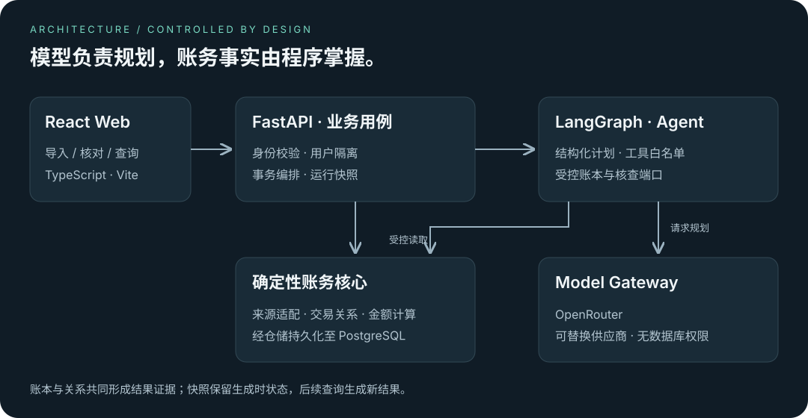

# 系统架构

BankPilot 将账本事实、关系判断和分析结果分开保存。金额与权限由确定性代码控制，模型负责选择受限的查询步骤。



## 模块职责

React 负责导入、账本、关系核对与 Agent 界面。FastAPI 验证会话和请求，应用服务组织事务；领域层实现来源解析、分类、交易关系与统计。PostgreSQL 保存用户数据和运行结果，Model Gateway 隔离 OpenRouter 接入。

来源适配器变化不应改变标准交易规则，模型供应商变化不应改变权限和金额口径。工作流通过端口访问领域能力，不直接编排数据库查询。

应用入口统一注入模型与核查端口，运行处理器不创建具体核查适配器。页面及查询期间保存在 URL 中，支持刷新恢复和浏览器前进后退；文件正文只保存在内存；待确认导入的配置、摘要与操作键保存在当前标签页 sessionStorage，用于刷新恢复。

## 从文件到证据

预览和导入复用解析契约。用户确认账户后，服务端重新校验并原子写入批次与交易。原文件在内存中处理，持久化交易保留批次和行号；分类修正和关系确认不覆盖原始金额。

Agent 在模型规划完成后读取用户账本。独立的核查端口在同一个数据库快照中装配期间交易、关系和证据，避免并发编辑使统计与证据来自不同状态。工作流使用该结果生成原始分析与调整分析，并将结果持久化。

重复打开运行记录读取已保存结果。该快照保留当时证据，不是当前账本的实时视图，也不等同于完整账本版本历史。

## 金额口径

重复关系由用户指定保留流水，只排除副本；本人转账排除已确认的双边收支；退款在到账日冲减流出。跨期的另一端作为证据保留，不移入本期统计。退款可能使本期调整流出为负。

候选限制为同币种：重复记录跨批次、等额且相差不超过一天；本人转账跨账户、等额反向且相差不超过三天；退款发生于支出后九十天内，累计不得超过原支出。服务端对人工配对同样复查事实、归属与并发版本。

原始统计与调整统计分别展示。分类汇总和异常规则基于原始交易，不应被标记为调整后的分类结果。

## Agent 边界

日期核查规划器仅接收用户任务及规划上下文，交易证据由本地服务装配。模型不能选择用户身份、修改交易、确认关系或绕过工具白名单；模型不可用不影响独立的导入与账本功能。

查询契约只接受日期范围，规划器对无法表达的附加筛选返回不支持。供应商响应的外层结构、计划和元数据均经校验，畸形响应统一返回模型输出无效。Web 按运行 ID 与修正请求序号接收异步结果，旧任务响应不能覆盖新运行。

快照包含原始交易、调整统计、规则与关系版本、双方证据和生成时间。覆盖信息只记录查询区间与读取数量，完整性保持未认证。候选截断单独标识，不能将部分数据包装为完整结果。

候选扩展窗口超过 10,000 笔时停止候选发现，另行完整读取期间流水和已保存关系的双边证据，继续提供确定性统计并标记候选未穷尽。只有期间流水自身超过 10,000 笔才要求缩小期间；任何截断集合均不得用于金额汇总。

## 代码组织

```text
web/src/app          页面注册、导航和跨页面期间
web/src/features     功能界面及各功能自己的状态 Hook
web/src/shared       跨业务 UI、期间、下载及错误处理
web/src/styles       基础、应用外壳、业务功能和响应式样式

api/.../api          按认证、账户、导入、交易、运行和报告拆分的 HTTP 路由
api/.../services     事务与用例编排
api/.../agent        模型规划、工具执行、结果组织
api/.../domain       解析、分类、金额与关系规则
api/.../adapters     领域端口与外部服务实现
api/.../db           按聚合拆分的仓储、ORM 模型与账本修订号

deploy               容器编排、环境示例与发布脚本
```

账本页面位于 `features/ledger`，历史模型核查位于 `features/agent`，对话助手位于 `features/assistant`。账本定位参数与账本组件同文件，调用方仅导入类型；账本 CSV 由服务端导出，月报快照 CSV 转换保留在月报详情组件内，文件下载复用 `shared/download`。规划错误文案归属规划模块，独立于月份 Hook；导入识别错误处理直接保留在导入流程中。仅在职责独立或实际复用时拆分文件。

应用按资源创建顺序登记清理操作，退出时逆序停止后台任务、关闭 HTTP 客户端和数据库引擎。启动失败或某项清理报错时，仍执行其余清理；外部注入的资源由调用方管理。

会话提供用户身份，业务查询强制用户隔离；密钥通过环境配置；数据库结构由 Alembic 管理；CI 使用独立数据库。周期扣款与预算使用独立规划服务，不参与月报任务调度；对话助手复用规划服务读取数据和确认预算修改。

## 月报快照与持久任务

月报复用 `ReviewGateway`，按月直接读取，不经过模型或 Agent 状态机。端口在同一个可重复读事务中先读取账本修订号，再读取流水、关系与证据；领域报告构建器复用原始统计规则。列表和状态查询不加载完整快照。

总览和关系工作区读取在认证前开启可重复读事务，认证与查询共享连接，不以用户写锁保护只读快照。总览 SQL 按期间过滤关系后聚合，只返回币种汇总和最近五条流水。

应用账本写入在同一事务内递增用户修订号。拒绝导入、没有新增流水的重复导入、重复保存相同分类、撤销无流水的批次不会递增。相关写入统一先锁用户，再锁源交易。跨月份共享用户修订号，因此提示表示账本发生变化，不断言本月金额变化。

持久报告记录合并一次生成任务与最终快照。提交按用户和幂等键唯一；领取使用 `FOR UPDATE SKIP LOCKED`，租约及领取令牌防止旧实例提交。删除使令牌失效并清除证据；用户级联清除也删除对应报告。首版仅支持手动触发，没有周期调度。

[运行手册](RUNBOOK.md) · [当前能力](CURRENT_STATE.md)


## 服务与页面边界

账户、月报和核查路由只处理 HTTP 契约、调用和提交结果；SQL 由对应仓储执行。核查服务负责重算证据、读取判断、锁定后重新验证，仓储不代替用例校验，也不隐式提交。总览是数据库只读投影，放在 `db/overview_repository.py`，直接返回 `OverviewSnapshot`；不再保留同名服务转发层。

核查列表使用 `ReviewList` / `ReviewItem`，运行历史使用 `RunHistory` / `RunHistoryItem` 明确响应字段。数据库中的可变 JSON 证据仍按原设计存储，不为了去掉 `Any` 而伪造固定模型。

月报页面负责月份、历史列表和分页；`useReports` 管理请求与任务生命周期；`ReportDetailPanel` 管理当前报告的删除确认和证据展开。详情组件以报告 ID 为 key，切换报告重置局部状态，刷新同一报告保留状态。

## 导入与离线恢复职责

statement_import 领域模块解析来源并保留全部源行分类依据，import_classification 在账户快照内统一去重和冲突。StatementImportService 结束预查询事务后解析，再锁用户重查 key、保存批次和流水。`api/errors.py` 统一全部接口的 `{detail: {code, message}}` 错误契约及 OpenAPI 响应模型；参数校验不回显原始输入，依赖不可用和内部异常不暴露 SQL 或异常原文。观测模块通过请求上下文与 SQLAlchemy 事件计时，不存储业务载荷。

数据库批次保存 idempotency_key、request_digest、parser_version 及完整计数，errors 仅保留有界明细；历史新增统计为 null。页面 importRecovery 负责最小配置持久化，useImportWorkflow 负责冻结输入、原 key 重试和结果展示。

CLI 的 database_backup 管理 pg_dump/pg_restore、清单和目标校验；restore_validation 管理只读数据证据和显式任务状态调整；schema_evidence 核对列定义、约束表达式与索引。它们不调用 create_app，不启动消费者或模型客户端。


来源识别由 domain/source_detection.detect_statement 一次读取返回来源、版本、表头、映射与账户币种；接口只转换响应，账户命名复用解析后的来源。前端 api 处理 HTTP 和成功写入的失效通知，账本、关系与月报的文件保存统一由 shared/download 完成。导入 hook 保留操作 key 归属检查，待确认记录的存储/ref/state 通过单一入口同步。


## 导入数据契约

解析成功时，`total_rows = new_rows + duplicate_rows + skipped_rows + error_rows`，`valid_rows = new_rows + duplicate_rows`。错误行按原始行号去重计数，issue_count 记录问题总数；预览展示最多 20 个有效行，错误与排除详情各最多 100 条，截断不改变完整计数。金额使用 Decimal，并以字符串传输。

稳定交易编号在同一账户内去重：同编号同事实首行新增、其余重复；同编号事实不同整组拒绝。无编号记录以规范化事实及出现次数识别，保留同文件内两笔相同交易，但不保证不同导出范围中的相同事实属于同一交易。未知来源状态拒绝入账，已识别但结构不完整的来源不得回退为标准 CSV。

任何行错误产生 REJECTED 批次、实际写入为零，不创建新账户；new_rows 仍表示提交时可新增数量。全重复/全排除均新增零笔。撤销删除该批实际流水，保留批次及提交时计数。历史新增统计保持 null，不推算或伪装为零；结构不可解析直接返回 422，不制造零行批次。

正式导入必须携带幂等 UUID。同用户/key 唯一，同 key 不同摘要返回 409；同 key 重试返回原批次，包括已撤销状态。摘要覆盖规范化文件名、原样正文、完整映射、账户 ID/名称和币种，不包含当前解析版本。预览不锁定账本，正式提交重新检查账户和重复事实，以最终批次计数为准。

认证和幂等预查询结束后释放事务，再在线程中解析；新的写事务锁用户、重查 key，原子保存批次、账户、流水和修订号。预览在解析后使用可重复读事务读取账户与事实。提交成功后才返回，不依赖提交后再查询来组装结果。

待确认导入在 sessionStorage 只保存用户 ID、key、请求/文本摘要及冻结配置，不保存文件正文。存储失败阻止提交；认证暂时过期保留记录，主动退出或用户不匹配清理。刷新先查 key；404 不证明原事务已回滚，重新选择文件须匹配文本摘要，再以原配置和原 key 重试。所有异步结果按操作 key 或文件选择序号隔离，不能覆盖后续操作。

## 周期扣款与月度预算

规划契约和日期计算放在 `domain/planning.py`，规划查询与持久化集中在 `db/planning_repository.py`，助手提案读写放在 `db/assistant_repository.py`，`services/budgets.py` 编排预算证据与额度写入，`services/recurring.py` 编排周期配置与核对，共享排除和容量规则集中在 `services/planning_evidence.py`。接口只负责认证、月份范围、参数验证和事务提交；两个页面共用月份请求状态，逐期流水选择独立为组件。

预算以用户、月首、分类和币种唯一保存正数额度。实际支出不落冗余汇总表：在认证前建立可重复读快照，读取当月完整流水、确认关系及退款原消费，复用现有分类规则与用户修正。确认重复的副本、本人转账双边排除；已确认退款按到账月、原消费当前分类冲减，未确认正向流水不冲减。退款可导致月支出为负。原始分类汇总及月报仍保留原口径，不伪装为预算统计。

预算返回确定性金额和逐笔贡献，退款附原消费证据。修改分类、确认或撤销关系、撤销导入后，重新读取即反映当前账本。月度流水超过 10,000 笔直接拒绝，不用截断集合统计。复制上月只新增缺少的分类/币种额度，不覆盖当前月份，也不结转余额。

周期项保存账户、商户、币种、预期金额、月付/年付与首次日期；按首次日期推算每一期，短月份取月末，之后恢复原锚点。初始配置保存在主记录，财务与日期变更追加到 `recurring_revisions`，按查看月份选取生效配置；新增配置不能早于当前业务月份，且必须晚于上一版生效月及已核对期次所在月，不覆盖历史预期。从流水创建项目保留原流水日期作为周期起点，不将短月截断后的日期写回锚点。名称纠正只更新项目名称。编辑请求携带查看月份与项目版本，避免已有未来配置时，单独改名意外修改财务配置。状态为跟踪/暂停/结束，按日生效的边界保存在 `recurring_status_changes`；按期次预计日期投影，不抹去暂停之前的历史待核对期次，不推断暂停期间银行已免扣。结束不可恢复，已关联记录仍可查看和解除。旧计划未知历史保留基线并明确标识，详细契约见下文 R8。

复制预算返回实际复制数与上月项数，区分无来源与全部已存在。净支出为正且未设置额度的分类/币种单独提示，复用同一账务证据。周期候选支持商户、日期和金额联合搜索，每页最多 10 笔；分页在完整读取的月度集合内进行，超过读取上限仍明确失败。周期编辑冲突保留输入，刷新后须显式确认最新版本。

每期最多关联一笔实际支出，每笔流水最多属于一期；允许用户跨月选择同账户、同币种流水，不要求商户文本和预计金额完全相同，金额不同明确提示。关联不改变交易关系或账本金额，不确认漏扣。撤销源流水通过外键解除关联；后续关系把流水排除后，页面标记需重核。预计扣款始终不进入预算实际支出。

写操作统一先锁用户并检查版本，旧版本不能覆盖新状态；预算同时校验记录身份，删除重建后旧表单失效；创建周期项使用客户端 UUID，重复相同请求返回原操作。预算月份、固定支出月份及账本期间在工作区 URL 中分别保存，切换月份、刷新及浏览器前进后退保持一致；页面保留挂载，通过月份和请求序号隔离响应；有草稿或写入时禁用月份控件，浏览器历史恢复保留草稿月份，旧写操作不能关闭新月份表单。浏览器请求按月份和序号隔离，写入失败保留表单。预算冲突刷新后展示最新额度，必须显式确认使用最新版本或重新建立，不能自动覆盖；周期页面刷新使跨月候选同时失效并重查，失效选项不可提交。所有页面金额来自服务端 Decimal；进度条只作比例展示。


用户明确确认的未发生期次保存在 `recurring_skips`，键为项目和预计日期；与实际匹配互斥，到期前不能确认，撤回不生成交易。未来配置修改/取消只能针对当前 UTC+08:00 月份之后且没有关联或未发生确认的区间；项目锁和版本检查复用现有写路径。

预算工作区在同一快照内返回分类支出和按币种覆盖范围，不另建汇总缓存。`services/planning_reads.py` 提供共享预算消费和固定支出期次读取；待办直接使用这些事实，不构造完整工作区或候选展示数据。API 写入成功统一发出账本/规划变更通知，工作区据此刷新总览、预算和固定支出；不再叠加助手或页面的保存回调。月报阅读摘要和 CSV 复用冻结快照；打印仅输出摘要，技术证据默认折叠，原始分类不改写为调整后统计。


总览期间通过 `overviewStart/overviewEnd` 独立保存，`start/end` 仅控制账本、关系核对与核查期间；显式下钻携带目标期间，普通导航保留筛选。预算和固定支出复用 `shared/DetailPanel` 的原生模态、Escape 与焦点恢复，草稿和面板显隐分离。周期列表筛选不卸载正在核对的详情，保存后状态变化仍能继续下一项。

预算覆盖按币种包含完整月度读取集合的流水数量与最近日期，来自同一查询快照，不能据此推断账单完整。下一计划日期遍历已安排配置的生效区间，复用月末/闰年日期规则；暂停区间可跨到已安排的恢复日期寻找下一期，结束区间无预测。总览关系候选按需读取，避免增加首屏扫描。人工配对规则单独位于 `pairEligibility.ts`，以整数分比较 Decimal 字符串，仅预筛当前快照；服务端保留最终关系事实、冲突与版本校验。月报提示和版本比较只读取保存的快照，不引入实时预算或分类数据。

## 对话助手

`domain/assistant.py` 定义严格的决策契约，`services/assistant.py` 执行最多 6 次模型决策的工具循环。每一步可读取一个月份的收支、预算、固定支出、发现候选汇总或单分类单币种消费，直接回答、追问，或提出预算修改。发现工具只给模型候选数量、规则版本和未认证覆盖状态；逐笔证据由页面直接读取。请求总预算为 90 秒，Web 代理读取超时为 120 秒；模型等待期间不持有数据库连接，不使用关键词匹配、固定工作流或模型失败回退。

模型接收当前对话、参考月份及所选工具返回的数据；预算流水证据、固定支出候选集合和总览最近流水不发送。模型文本属于解释层，用户可以展开服务端统计核对，不能作为写入或成功的证明。历史核查快照流程仍独立保留。

`domain/spending.py` 定义消费范围、汇总和分页契约，`services/spending.py` 统一装配完整月份的消费贡献、分类合计及导入覆盖；预算工作区在这一结果上叠加额度。`spending` 返回单项汇总，`budgets.spending_refs` 返回同结构引用，前端统一显示金额与明细入口。多个工具返回同范围、同账本及计算版本的引用时合并展示。

`GET /api/v1/assistant/spending-evidence` 在认证前建立可重复读事务，检查 `expected_revision` 与 `expected_calculation_version`，再按相同范围读取完整集合并分页。金额从完整证据计算；顺序为入账日降序、交易 ID 升序，每页 20 条。任何版本冲突返回 `assistant_evidence_stale`，不混入当前明细。计算版本由共享模块维护，分类、退款、排除及排序语义变化时必须更新；它不替代预算乐观版本或数据库迁移版本。

对话请求可携带严格校验的 `spending_context`，只包含月份、分类和币种，作为追问线索。它不携带可信金额或用户身份；所有查询仍按认证用户执行。逐笔明细直达浏览器，不发送给模型。消费明细在助手侧栏中切换展示；目标流水通过账本入口定位并临时解除筛选，返回助手时恢复原账本期间及筛选。账本写入事件即时标记本地答案失效，服务端双版本检查保护外部写入和规则升级；分页请求按当前视图归属接收结果。

`assistant_actions` 保存 15 分钟有效的预算提案、原额度、目标额度、目标预算 ID 与版本。确认接口只接受提案 ID，从已认证用户归属读取提案；提案行锁、既有规划服务用户锁和乐观版本校验共同保护写入。更新与冻结回执同事务提交；重复确认读取同一回执，取消后不可执行。恢复准备取消所有待确认提案。模型无法调用确认接口。

Web 全局侧栏保留当前页面上下文，答案、查询依据、确认差异分层展示。会话与完整轮次保存在数据库；模型上下文最多读取最近 7 个成功轮次并受字符上限约束，页面历史不随上下文截断。操作提案及回执保存在数据库。预算确认后刷新已打开的预算页面和总览提醒，保留编辑草稿。当前操作仅涵盖预算设置/修改，不支持关系修改、固定支出创建、外部提醒或银行操作。


## 事务与异常边界

接收调用方 `AsyncSession` 的业务写入服务只修改或 flush，不提交；预算、周期、关系、助手确认/取消由 HTTP 路由在成功响应前提交。自行创建事务的导入用例、助手提案及离线恢复负责自身事务，不能包进外部事务后提前提交。

规划页面只管理编辑会话、导航和列表；预算与周期编辑器持有字段、校验及版本确认状态。收起或跨页时编辑器保持挂载，成功或取消才释放草稿。周期账户读取随页面重新激活而刷新；加载、失败、空账户分别显示，读取失败保留已有列表与草稿，阻止使用未确认的账户状态保存，并提供重试。保存失败保留表单；写入已成功但重读失败明确告知“已保存”，避免用户误以为写入失败而重复操作。前端只接受结构化错误契约，由 `shared/apiErrors.ts` 处理通用状态，各业务按错误码补充处理建议，不按消息原文推断类型。助手区分认证过期、模型不可用、无效输出、超时和容量错误，保留输入，不伪造成功或空结果。


## 会话与轮次

`ConversationService` 管理受理、完成、读取、分页和超时收敛；助手仓储提供归属锁、
删除和过期状态操作。模型工具循环只返回提案数据，不直接保存提案。
会话首次创建与首轮受理原子提交；同用户创建标识、同会话请求标识和序号均受唯一约束保护。
数据库部分唯一索引约束每个会话至多一个 processing 轮次。

所有助手写路径先锁用户，模型等待不持有事务。完成时重新锁用户与会话，
按 processing、完成令牌和数据库截止时间条件写回；提案与结果同事务保存。
删除先清除轮次并取消待确认提案，再清空会话内容，仅保留归属与去重身份。
预算确认也先取得用户锁，因而与删除/完成串行；已执行回执不会被聊天删除或重复确认改写。

历史结果带结构版本。未知版本仅显示安全文本；已保存汇总不重算，明细沿用账本修订号与计算版本双校验。
提案状态投影另算 effective_status/can_confirm，读取不写预算，也不延长有效期。
客户端仅提交新问题与结构化范围；模型历史由服务端读取，不接受伪造的历史助手角色。

Web 的 useConversations 负责用户隔离的 sessionStorage 恢复记录与请求归属。
发送前保存原输入及原标识，受理确认后删除正文；不明状态先查原请求，只由用户显式重试。
处理中每 3 秒查询，面板隐藏暂停；完成后每 15 秒重读提案状态，仍不调用模型。
退出立即失效响应归属后再注销 Cookie，迟到结果不能重新创建已清除的本地记录。

## 受限流水查找

`domain/transaction_search.py` 定义严格条件、规范化与分页契约；`services/transaction_search.py` 统一完整匹配、详情与 CSV。仓储先限定用户、日期、账户、币种、方向、绝对金额和批次，最多取 10,001 笔判定容量；10,000 笔内装配最终分类、规范化匹配后稳定分页。已确认关系仅作为原流水状态，不沿用消费排除或退款归属。匹配版本为 `search-v1`，分类依赖变化须同步升级。

POST search/export 将个人查询文本放请求体；URL hash 仅在浏览器恢复显式条件。搜索、导出、详情及核查投影共用认证前的可重复读事务；分类写入在用户锁内直接读取当前修订标量。核查先在完整期间运行规则，再投影当前页相关项，证据不从当前页拼接。

助手 `find_transactions` 复用同一服务，逐笔内容直达前端并保存有界首屏历史，模型仅接收条件、数量和状态。同名账户先确定性澄清。手动结果暂存面板，保存成功后成为续问范围。

协议 5 的会话请求携带上下文版本；消费范围修改、查找条件修改及轮次受理均递增版本。独立查找条件冻结进轮次，完成不回写会话条件。删除与恢复准备清除查找文本，恢复墓碑的上下文版本归零以保持幂等，仍拒绝旧请求重放。

## 同口径消费比较

`compare_spending` 只接收两个有序月首和一个币种。模型负责识别范围；一旦选择工具，服务端在同一个可重复读快照内计算两期消费、已确认退款、实际支出和分类并集差额，并直接结束工具循环。比较结果不会再次发送给模型，最终轮次也不保留此前搜索或逐笔观察。

目标月为当前业务月份时，两侧按同一日序号截断，短月份取月末；已结束目标月按两个完整自然月计算。查询范围、已观察流水范围和账单完整性分别展示。分类差额之和、消费差额减退款差额和总实际支出差额必须一致，否则整次失败。

结果保存 `spending-v1`、`comparison-v1` 和账本修订号。`GET /api/v1/assistant/turns/{turn_id}/comparison-evidence` 仅从当前用户已完成的结果版本 3 或 4 轮次恢复可信范围，客户端只能选择侧别、已保存分类和页码。任一版本或账本修订不一致返回 409；历史合计仍可读。结构化重新比较从原轮次复用双月与币种，按新轮次业务日期重算，不调用模型，也不改变已选择的消费或搜索上下文。

所有助手接口统一要求 `X-Assistant-Protocol: 5`，提交体只接受协议 5，新结果只写版本 4。已有版本 3 的结果仍按原结构读取，其他旧版本结果仅返回身份、问题和状态，以及 `assistant_result_unavailable`，不返回旧正文、证据、提案或模型历史；旧本地待处理请求不自动重放。

不支持版本的本地待处理记录保存在独立的用户级 `assistant-unverified` 键中，新请求不能覆盖。用户显式核对只使用原请求身份调用最新查回接口；未查到或会话切换后的迟到响应不清除记录，不转换旧请求正文或自动重放。比较卡各自追踪本地变更状态，新结果不继承旧卡失效状态。比较分类证据覆盖冻结结果的全部分类；负金额流水被用户标为 `income` 时仍可核对其消费贡献，金额口径不变。

## 待办状态与提醒偏好

六类待办由确定性服务端事实生成，GET 只读；预算与固定支出在独立可重复读快照中读取，分组失败不解释为空列表。认证会话先释放连接，再依次打开分组快照。

业务服务在原事务 flush 后归一化受影响状态并生成通知事件；同步范围显式限定月份或来源，撤销在级联删除前捕获跨月依赖。新预算与周期计划仅发现当前通知窗口的首次事实，不预生成历史期次。源预算删除清理状态；暂时不成立的周期事实保留 inactive 状态。

### 状态语义

#### 稳定身份

- 预算：`预算记录 ID + 月份 + 币种`。删除后重建预算会得到新 ID，不继承旧状态。
- 固定支出：`周期项目 ID + 预计日期`。同一项目不同期次互不覆盖。
- 类型关闭按用户和提醒类型保存，不影响其他用户和其他类型。

客户端不提交可信身份字符串。写入状态时提交结构化来源和服务端返回的 `fact_token`；服务端重新计算当前事实、校验用户归属和 token 后再写入。

#### 已读

“已读”只隐藏当前待办实例，不改变预算、流水、周期项目或核对状态。默认列表优先显示未读，用户可展开已读项目。

#### 稍后处理

客户端仅提交固定选项，由服务端确定绝对到期时间：两小时后、明天 09:00、七天后 09:00。日历选项使用现有规划口径 Asia/Shanghai，存储为 UTC；不得使用浏览器时钟计算可信期限。“七天后”指当地日期加七天后的 09:00，不是严格 168 小时上限。例如 9 月 22 日 08:00 选择该选项，到期为 9 月 29 日 09:00，七天一小时是合法结果。不接收任意自定义期限；超过日期支持上限返回参数错误。

到期前从默认列表隐藏，到期后 R5 读取投影为未读；R7 扫描持久化通知转换。返回值包含服务端时间与绝对到期时间；到期后的状态版本令牌使用不同的到期阶段，旧请求不能再次隐藏已经到期的项目。重复操作返回首次冻结的到期时间，不能从重试时间重新延后。

#### 类型关闭

关闭类型后，该类型不进入默认列表，但业务事实仍正常计算。重新开启后按各项当前未读、已读或稍后状态恢复展示，不自动清空单项状态；关闭偏好不等于业务完成。

#### 重新打开

业务事实与用户阅读状态分开版本化。每个已有用户状态的来源保留 `generation` 和最近业务事实，包括事实不成立的阶段；重新成立或提醒类型变化时递增 generation，用户状态重置为未读。不依赖用户是否打开过总览。预算等级降低但仍告警也视为类型变化；同一等级内金额变化只更新展示，不反复重开。名称等文案变化不重开。

在影响已有状态的业务写事务内同步维护事实：预算创建、修改、复制、删除；流水导入、撤销、分类修改；关系确认、撤销；固定支出配置、暂停恢复、匹配解除、未发生确认及撤回。同步发生在业务修改 flush 后、提交前，与业务变更一同回滚。包括退款原消费改类影响的其他月份、关联流水被关系排除等跨期依赖；不能仅按正在查看的月份筛选。无关联状态的来源保持按需计算、默认未读，无需预生成全部历史期次。

所有上述写路径必须覆盖受影响来源与跨期依赖。正常可计算期间不得只写“已脏”标记后等读取时重算，否则连续两次写入之间的消失和重现仍会丢失。按受影响月份复用一次共享金额计算，避免每条状态重复读取账本。该同步计算带来的写入耗时纳入验收。

如果仅待办计算超过既有确定性容量上限，业务写入仍按自身规则执行；在同一事务中将受影响的已有状态标为 `unknown`，首次进入 unknown 时递增 generation 和 revision、清除旧已读/稍后状态并记录原因及开始时间。连续处于 unknown 不重复重开，旧令牌始终无效；不得把 unknown 当作事实消失，也不得根据截断数据生成金额。这里只处理明确的容量错误，不吞掉数据库错误或程序异常；unknown 标记无法原子保存时事务仍失败。

unknown 期间展示“暂时无法计算”，禁止新的单项状态操作，不影响类型偏好修改和其他可用组。恢复完整计算后，当前成立的事实以一次新的未读实例出现；不成立则转为已知的不活跃事实。保留“期间变化未完整追踪”的结构化原因供验收核对，不声称复原期间每次变化。GET 可以只读投影该恢复结果；下一次相关业务写入或单项操作按下述归一化规则将其落库。每次 unknown 到 known 只递增一次代次。

`fact_token` 绑定用户、来源、generation、当前提醒类型和规则版本；固定支出的到期阶段由服务端日期推导，到期当日即为待核对。时间从即将到期推进到待核对时，旧类型状态不再适用，R5 GET 无需后台写入即可投影新类型；R7 扫描负责持久化通知所需的转换。GET 只读，不创建状态、不更新“已观察”标记，也不清理记录。

GET 和所有相关写路径共用一个无副作用的归一化函数，以持久化状态、完整当前事实和本次请求固定的服务端时间为输入，返回有效事实签名、generation、revision、用户状态和期限。时间类型推进、unknown 恢复等尚未落库的变化在投影中生成有效新版本；重复读取同一底层状态时得到相同版本，不逐次累加。事实签名只包含会影响待办状态的语义字段，不包含名称等展示文案。

单项状态写入取得用户锁后先归一化，用有效版本校验请求，再将归一化事实签名、提醒类型、代次与新用户状态原子保存；业务写入也保存同一归一化结果。若发生归一化重开与用户操作，版本分别按规则推进，但同一时间转换只能消费一次。下一次名称修改等无语义变化的写入读到已保存的新签名，必须保持已读状态和代次。稍后到期同样先归一化为未读并清除已消费期限，之后用户选择已读不得再次被该旧期限失效。

#### 并发与重试

状态请求携带 `fact_token`、`expected_state_version` 和客户端 UUID `operation_id`。状态版本令牌包含持久化 revision 与稍后到期阶段；首次无记录使用版本 0。任何用户操作和业务驱动重开都递增 revision；恢复未读保留行，避免删除再建后旧版本重新有效。

状态写入沿用现有业务顺序：先锁用户，再读取当前事实和状态，校验版本后条件更新。业务写入和待办写入使用同一用户锁串行化；写路径使用锁后新读取的数据，不复用认证前固定的旧快照。多行修改按稳定来源顺序执行。

幂等回执按用户与 operation_id 唯一保存，绑定完整请求摘要，与状态修改原子提交。同 key 同请求只返回原回执、不再次修改状态；同 key 不同请求返回冲突。回执可在当前事实变化后继续查回，前端收到回执后重新读取列表，不用旧回执覆盖新状态。类型偏好写入使用同一机制；缺省偏好版本为 0，首次创建同样执行条件校验。

### 数据设计

迁移 `20260922_0015` 建立以下三张表；`20260929_0018` 另为状态增加通知窗口标识：

#### `attention_states`

- `user_id`
- `source_type`
- `source_id`
- `source_date`
- `attention_type`
- `generation`、`fact_signature`：实例代次及最近的确定性业务状态
- `fact_status`：`active`、`inactive` 或 `unknown`；unknown 不等价于 inactive
- `unknown_reason`、`unknown_since`：当前不可计算原因及起始时间
- `last_tracking_gap`：最近一段不可计算区间及原因，恢复后保留，不保存账务明细
- `revision`：用户状态与业务重开的单调版本
- `state`：`unread`、`read` 或 `snoozed`
- `state_attention_type`：用户操作时的提醒类型，保护时间推进后的新类型
- `snoozed_until`
- `notification_window`：R7 记录已进入通知窗口，不参与金额判断
- `created_at`、`updated_at`

用户、来源类型、来源 ID 和日期构成唯一身份；所有读取和写入都附带 `user_id`。source_id 指向不可复用的预算或项目身份。源对象删除时在同一业务事务中删除对应状态；事实暂时不成立或不可计算时必须保留状态行。用户删除级联清除。为用户、来源和日期建立索引，并约束版本正数、状态枚举及 snoozed 状态必须有到期时间；unknown 必须带原因和开始时间且不得保留已读/稍后状态。

#### `attention_preferences`

- `user_id`
- `attention_type`
- `enabled`
- `version`
- `updated_at`

缺少记录等价于开启。修改携带 `expected_version`，防止多个标签页互相覆盖。

#### `attention_operations`

- `user_id`、`operation_id`：联合唯一键
- `request_digest`：包括操作种类、目标、期望版本与参数
- `receipt`：最小冻结回执，包括已接受版本和绝对稍后期限，不包含账务明细
- `created_at`

当前不按时间清理回执，避免旧请求过期后重新执行；用户删除时级联清除。

备份包含三张表并同步结构版本。恢复准备保留状态、偏好与回执；恢复后的稍后状态按当前服务端时间投影，过期项目重新未读。R7 事件与排程的恢复抑制规则见 [通知契约](ARCHITECTURE.md#r7-事务通知)。必须实际验证备份还原后状态、偏好、回执去重及恢复准备重复执行。

### 服务与接口

实现位于 `domain/attention.py`、`db/attention_repository.py`、`services/attention.py` 和 `api/attention.py`。复用现有预算和固定支出的确定性计算，不复制账务算法。共享事实计算不得反向调用写服务，避免业务服务与待办服务循环依赖。

预算与固定支出分别使用独立的可重复读会话，认证后始终以服务端用户身份读取。禁止在同一个 AsyncSession 上并发查询。每组在自己的快照内合并事实、状态与偏好，返回组内读取时间和版本；不承诺两组构成同一瞬时快照。

响应按组返回 `status: ready | unavailable`、安全错误码、可重试标志和数据。单组失败时 HTTP 200 返回另一组可用数据；两组均失败或公共认证/基础设施不可用时返回统一错误。前端对失败组显示读取失败，计数标明不完整；不得将失败或容量拒绝解释为空列表，也不得清除该组持久化状态。重试允许只请求失败组。

接口契约：

- `GET /api/v1/attention?month=YYYY-MM-01&group=all`：group 可为 all、budgets、recurring；返回组状态、未读项、已读项、稍后项、关闭类型计数及偏好，并附 `server_time` 和 `next_refresh_at`。稍后项包含来源、token、状态版本和到期时间，可提前恢复。
- `GET /api/v1/attention/preferences`：独立读取当前用户的六类偏好，不依赖事实计算；两组均不可用时仍能读取和修改设置。
- `POST /api/v1/attention/state`：标记已读、稍后处理或恢复未读；携带事实 token、状态版本、operation_id，返回冻结操作回执。
- `POST /api/v1/attention/preferences/{attention_type}`：启用或关闭类型，携带偏好版本和 operation_id。偏好关闭优先于单项状态；重新开启保留仍有效的已读和稍后状态，仅恢复该类型的可访问性。

返回项包含稳定来源、展示数据、当前状态、`fact_token` 和业务页面定位参数。金额仍使用 Decimal 字符串；页面不得根据百分比重新判断业务类型。

错误契约：

- 当前事实不存在：`attention_not_found`。
- 当前事实超过计算容量：`attention_unavailable`（422），保留来源并要求减少计算范围或等待数据调整，不伪装为 404；幂等成功回执仍可重放返回。
- token 已过期：`attention_stale`，页面刷新列表，不自动重放操作。
- 稍后时间非法：`invalid_snooze_time`。
- 偏好版本冲突：`attention_preference_conflict`。
- 用户状态版本冲突：`attention_state_conflict`，保留操作意图并重读，用户重新操作时使用新 key。
- 相同操作 key 的请求内容不同：`attention_operation_conflict`。
- 冲突均为 HTTP 409，事实不存在为 404，参数错误为 422；基础设施不可用为 503。网络结果不明时只允许用原 key 和原请求重试。

### 前端交互

`NextActions` 读取待办接口：

- 卡片主操作仍进入预算或固定支出页面。
- 次操作提供“已读”“稍后处理”；选项为“两小时后”“明天 09:00”“七天后 09:00”，展示 Asia/Shanghai 时间。
- 提供“稍后处理”列表，显示期限并支持提前恢复未读；已读列表也可恢复未读。
- 接受回执后重读对应分组；结果不明保留原请求和 key。按用户、月份、分组及请求序号隔离响应，旧响应不得覆盖新列表。
- 列表读取不得清除结果未明的原操作及 key；确认前阻止替代写入。定时刷新不依赖前次读取成功，首次读取失败仍注册网络恢复监听。
- 原请求在发送前写入用户隔离的 sessionStorage，覆盖状态和偏好操作；存储失败不得发送。切页、刷新和认证暂时过期保留原 key、版本和请求，恢复后由用户显式重试，不自动发送。确定成功或确定拒绝后清理；主动退出清理，用户不匹配不得重放。损坏或不可读记录阻止新写入，迟到结果只能清理同一 operation_id。
- 读取状态、错误和新鲜度按组保存；一组成功不得清除另一组失败。账本变更通知同时使总览金额和待办失效，刷新期间旧快照明确标记。
- 顶部显示未读数量，并提供“显示已读”“稍后处理”和“提醒设置”；分组失败时不显示误导性的全量零计数。
- 服务端 next_refresh_at 取最早稍后到期时间或下一业务日边界。页面可见时按服务端时间差设置定时重读，最迟每 60 秒刷新可见分组；隐藏时暂停，重新可见、获得焦点或网络恢复时立即重读。浏览器休眠后以服务端结果为准，在线可见页面到期后 60 秒内更新。
- 关闭某类提醒必须二次确认，文案明确“只隐藏提醒，不修改账务事实”。
- 375px 下操作纵向排列；键盘焦点在操作完成后移动到下一项或空状态。

中英文文案同时交付，不新增口号、解释性大段文本或独立设置页面。

## 固定支出候选发现

候选只用于核对，不是已确认订阅或漏扣预测。金额、账户归属、关系排除、证据和写入由服务端决定；默认开关关闭，启用门槛见 [路线图](ROADMAP.md#r6-发现验收与扩展)。

### 发现输入与规则

#### 证据范围

- 查询必须绑定认证用户；同一可重复读快照中读取 12 个完整月、账户、确认关系、已有计划及发现决策。最多读取 10,001 笔以判定 10,000 笔容量；超限返回明确错误，不用前 10,000 笔推断“无候选”或精确率。
- 仅纳入负金额、有效账户、同一币种的实际导入流水。已确认重复关系的副本与本人转账双边按现有 `planning_evidence.excluded_ids` 排除；已关联固定支出期次的流水仍可作为证据，但其候选应归为“已有项目”而非重复创建。对窗口内扣款 ID 查询全部已确认退款关系，包括退款到账日在窗口外的关系；有任一退款关系的原扣款不计作有效观测，并显示“该笔存在已确认退款，未参与识别”。R6 不区分部分/全额退款，也不新增净额算法。关系读取失败或超限时整次发现不可用，不能把退款当作未发生。
- 账单来源、批次和行号只用于追溯。导入有空月、失败批次或未知覆盖时，标为“未观察到/覆盖未认证”；不得把空月说成未扣款。当前不持久化“账单已完整导入”断言。

#### 规范化与成组

- 候选组键由 `user_id + account_id + currency + normalized_merchant` 唯一确定。商户规范化使用独立于识别规则的 `merchant_normalization_version`：当前规则为 Unicode NFKC、去首尾空白、内部空白折叠、大小写折叠；保留数字、标点和平台后缀，不凭模糊相似度合并不同商户。空值、只有支付平台通用名称或规范化后无可识别商户的记录不给出候选，报告原因。只读发现接口和持久决策均返回或保存 `merchant-normalization-v1`。
- 同组每个自然月只能有一笔可用扣款；若同月多笔、不同价格档位或可疑拆分无法唯一归属，标为“不明确”，不自动挑一笔。不同账户或币种永不合并。组键不包含价格、观察月份或识别规则版本，以便新账单到来后忽略/关联决定保持归属；规范化版本变化前必须先关闭发现入口，再以新迁移为旧决策逐条映射新组键并处理碰撞。不能确定一对一映射时保持入口关闭并停止该版本升级，另行设计人工核对流程；任何保存版本与运行版本不一致的读取或写入必须明确失败，不得让旧决策静默失效或误命中新组。
- 初始保守规则：最近 12 个完整月内，最近 3 个有效观测必须分属连续 3 个自然月，且最后一笔位于截止月或其前一月。以这 3 笔的账单日作为锚点，月末按现有 `due_in_month` 截短；窗口内其他观测日期相对锚点不超过 3 天。金额使用 `Decimal` 比较，所有有效观测相对中位数的偏差不超过 10%；不跨币种换算。不满足条件只返回证据不足或不明确，绝不推断已停扣。
- 这些 3 个月、3 天、10% 和最近 2 个月是待标注样本校准的规则初值，不是已验证精度。规则版本记录在响应和提案中；调整阈值必须升规则版本并重跑独立评估，不通过运行时环境变量静默改变候选含义。

候选按最近观测日期降序、组键升序稳定排序；每组返回最多 12 条本窗口观测。组键在服务端按上述四元组做 SHA-256，客户端只当不透明 ID 使用。响应包含完整窗口的观测数、被排除原因计数、查询账本修订号、发现规则版本、商户规范化版本和 `evidence_digest`。摘要覆盖成员交易 ID、日期、原始金额、确认关系、组键及规则版本；不把展示名称或模型文字当作证据版本。列表另返回 `discovery_snapshot_token`：在同一快照内由账本修订号、规则版本、规范化版本、候选排序与归类、相关计划及其配置/逐期匹配、发现决策及版本生成。每页重新计算完整结果并校验令牌；任何可见结果变化都拒绝旧页码，不仅检查账本修订号。

### 决策、提案与并发

#### 发现决策

`recurring_discovery_decisions` 按用户和稳定组键唯一保存 `active | ignored | linked | created`、目标计划 ID、单调版本、`merchant_normalization_version`、最小组身份及时间。无记录等价于 `active`、版本 0；恢复忽略或解除关联时保留 `active` 行并推进版本。`linked` 表示用户选择已有计划，`created` 表示通过本发现提案新建，两者都必须保存目标计划 ID；`active/ignored` 不得保存目标计划 ID。忽略后默认隐藏，用户可在“已忽略”视图恢复；关联只隐藏重复推荐，不写入逐期匹配。目标计划必须属于同一用户，且其在候选最近观测月份生效的配置与候选账户、币种一致；结束和暂停计划仍参与重复检查。商户或账户后续修改若使关联不再符合当前组键，列表提示“需重新核对”，不能悄悄重指向另一计划。

忽略、恢复、关联、解除均携带期望决策版本与客户端 `operation_id`。`recurring_discovery_operations` 按用户与操作 ID 唯一保存请求摘要和冻结回执：同 key 同请求只回放，同 key 不同内容返回 409。先锁用户、重读当前组和目标计划，再写决策与回执；数据库错误整体回滚。读取不创建决策或回执。客户端在发送前持久化不含流水正文的原请求，结果不明时只允许原 key/原载荷重试。

#### 新建提案

`POST /api/v1/recurring/discovery/proposals` 接收客户端 `proposal_request_id`、组键、截止月份 `through`、`evidence_digest`、`discovery_snapshot_token`、预期决策版本和不含计划 ID 的 `RecurringDiscoveryDraft`（名称、商户、账户、币种、金额、固定为月付的周期及首次日期）。截止月份沿用发现接口的完整月校验；首次日期必须晚于当前 Asia/Shanghai 业务日。账户和币种须等于候选证据，草稿商户规范化后须等于候选商户；如需改为其他商户，转现有手工建项，不将旧证据绑定到新商户。服务端在用户锁内先按请求 ID 查回放，再用同一截止月份重算完整发现快照并校验令牌、组状态为可创建候选、证据摘要与决策版本。服务端生成并冻结提案 ID 与计划 ID，随后用冻结计划 ID 组装现有 `RecurringInput`，复用现有创建服务的账户/币种校验及幂等身份规则。返回 15 分钟到期时间、原样参数、最多 12 条来源交易 ID/日期/金额及创建后不会自动关联历史期次的说明。提案仅保存最小证据引用和摘要，不复制原始描述或账单正文。同用户、同 `proposal_request_id`、同请求摘要回放同一提案；同 key 异载荷返回 409，创建请求响应丢失时可原样重试，不生成第二个提案。

`POST /api/v1/recurring/discovery/proposals/{id}/confirm` 仅接收提案 ID；先锁用户，再读取归属提案。已确认提案先回放冻结回执，即使 15 分钟期限已过也不再次创建。未确认提案先检查期限，再以冻结的截止月份按最新账本修订、规则版本、候选组、证据摘要、决策版本与目标账户重算；同账户、币种、规范化商户已有计划时先返回重复冲突，其余快照差异返回失效冲突。用户需重读后重新生成提案，不自动沿用旧参数。

提案创建和确认前均检查同账户、同币种、规范化商户的全部已有计划（含暂停、结束及历史/未来配置），以及同组已忽略或关联决定。已有计划时返回冲突与可打开的已有计划 ID；用户须显式选择关联或另走现有手工创建流程。此重复保护覆盖发现确认路径；现有手工建项接口仍允许用户自主创建同商户计划，不宣称全系统唯一。服务端在同一用户锁事务中创建 `recurring_plans`、标记提案已确认、保存冻结回执并将该组决策写为 `created`；不生成 `recurring_matches`。确认时再次校验冻结首次日期仍晚于当前业务日；过期则要求重做提案，不把已过去的日期作为新计划起点。确认失败不得留下部分计划、决策或回执。

`recurring_discovery_proposals` 保存用户、`proposal_request_id` 与请求摘要、候选组键、截止月份、快照令牌、预期决策版本、规则/账本版本、证据摘要、冻结账户名称、完整确认参数、服务端固定计划 ID、有效期、状态和冻结回执。已确认回执保留至用户删除，保证长期重试不重复建项；新建提案时将到期未确认提案压缩为 `expired` 墓碑，清空草稿和证据，旧 ID 与请求 ID 仍不可重新执行。同用户最多保留 20 个未到期待确认提案，超出返回 422。过期墓碑的元数据仍会长期增长，后续需监控表容量。迁移 `20260929_0016` 建立发现决策及操作表，`20260929_0017` 建立提案表；不改写已发布迁移。提案使用用户外键级联、用户范围唯一键和必要索引；提案的 `id` 与固定计划 ID 全局唯一。备份、恢复、用户级联清理和表容量观测纳入迁移验收。

### 接口与错误契约

- `GET /api/v1/recurring/discovery?through=YYYY-MM-01&offset=0`：`through` 必须是完整月的月首；每页最多 20 组，返回窗口、账本/规则版本、商户规范化版本、`discovery_snapshot_token`、覆盖说明、当前有效组的有界列表和各类总数。规则分类与用户决策为两个字段；默认只列 `active` 组，`ignored/linked` 不混入当前候选。下一页请求须携带首次读取的 `discovery_snapshot_token`；服务端重算完整结果，令牌变化返回 409 并从第一页重读。分页必须在完整分组与排序后执行，不能只扫描第一页；超限直接 422。
- `GET /api/v1/recurring/discovery/decisions?status=ignored|linked&offset=0`：只从当前用户保存的决定读取历史，每页最多 20 条，按更新时间降序、组键升序排列；返回最小组身份、规范化版本、状态、版本、目标计划 ID、`evidence_status` 和 `decision_snapshot_token`。该列表不扫描交易，不受发现的 10,000 笔容量限制；默认 `evidence_status=not_checked`，只有一次成功的当前窗口证据核对才可标记 `present` 或 `missing`，容量错误时不得声称“没有证据”。翻页令牌覆盖本用户决定及版本，变化后返回 409。
- `GET /api/v1/recurring/discovery/decisions/{group_key}/evidence?through=YYYY-MM-01`：按当前用户已保存的决定查回组身份，再使用同一完整发现快照规则核对该组；成功时返回 `present` 或 `missing`，超限时返回 422 且历史决定仍可独立查看和撤销。不为不存在或其他用户的组泄露证据。
- `POST /api/v1/recurring/discovery/decisions`：忽略、恢复、关联、解除；均携带组键、期望决策版本和 `operation_id`；首次忽略或关联还须携带截止月份、`evidence_digest` 与 `discovery_snapshot_token`，关联另须携带目标计划 ID。成功和同 key 回放均返回同一冻结回执：操作 ID、组键、新状态、新版本、目标计划 ID（如有）和最小组身份。
- `POST /api/v1/recurring/discovery/proposals`：携带 `proposal_request_id`、组键、截止月份、证据摘要、发现快照令牌、预期决策版本及无计划 ID 的完整草稿；返回完整可复核提案，不直接写计划。
- `POST /api/v1/recurring/discovery/proposals/{id}/confirm`：确认或回放冻结创建结果。提案只可由所属用户读取/确认。
- `GET /api/v1/recurring/discovery/proposals/{id}`：按用户读取原样冻结提案、状态和回执，供刷新及结果不明时查回；未知 ID 和其他用户 ID 均返回 404。

除只返回 `enabled` 的认证可用性接口外，所有发现读取与写入均受同一个服务端默认关闭开关约束。关闭时不读取或修改发现决策与回执；重新启用后，原操作 ID 仍按原样回放。

统一 `{detail:{code,message}}`：`discovery_capacity` 与 `discovery_proposal_capacity` 为 422；`discovery_evidence_stale`（含计划或决定改变后的旧快照）、`discovery_decision_conflict`（版本或非法状态转换）、`discovery_duplicate_plan`、`discovery_operation_conflict` 为 409；`discovery_duplicate_plan` 的 `detail.target_plan_id` 返回当前用户已有计划 ID；`discovery_proposal_expired` 为 409；不存在或不属于当前用户返回不泄露归属的 404，发现开关关闭时返回 404 `discovery_unavailable`，依赖不可用为 503。错误不回显其他用户的商户、交易或计划。网络结果不明时页面保留原提案 ID/`proposal_request_id`/操作 ID；提案创建用原请求 ID 重试，确认先按提案 ID 查回或原样重试，不生成新确认。

### 界面与助手

固定支出页增加“发现可能的月付项目”入口和独立抽屉；不混入现有逐期交易候选列表。卡片先给出实际观测与范围，再给动作。证据不足、不明确、已有项目、已忽略和读取失败有不同状态；切换月份或账号时旧响应不能覆盖新视图。编辑提案沿用当前固定支出表单字段，但确认页独立展示冻结参数和证据；金额始终由服务端 Decimal 字符串提供。

助手提供一个只读发现工具，返回有界候选数量、规则版本、覆盖状态与打开固定支出发现视图的目标；逐笔证据不发送模型。助手协议为 5、结果版本为 4，旧客户端请求被拒绝，历史版本 3 结果仍可读取。模型回复不能替代页面证据或确认。真实模型能否正确选择工具、解释“可能”与“证据不足”另行验收；失败时用户仍能从页面完成流程。

## R7 事务通知

通知覆盖六类 R5 待办，默认关闭；实际证据与未完成门槛见 [R7 本地记录](R7_ACCEPTANCE.md)。启用、备份与恢复操作见 [运行手册](RUNBOOK.md#r7-站内通知)。

### 范围和语义

- 本轮事件来源仅为 R5 的三类预算待办与三类固定支出待办。预算按预算 ID 和月份，固定支出按计划 ID 和预计日期定位；使用已有 `attention_states.generation` 和确定性 `AttentionType`。
- `attention.opened`：原本不成立的事实变为待处理、等级或类型改变、`unknown` 恢复为可计算且当前成立，或者新业务写入首次产生符合通知窗口的事实。只有事务内持久化的状态转换可发事件。已存在的事实不因部署、首次打开页面或首次扫描而补发历史通知。
- `attention.snooze_due`：稍后期限届满且事实仍成立时产生一次；同一状态版本只能产生一次。用户主动恢复未读不产生新的通知。
- 业务金额或名称仅改变展示文本而 `AttentionFact.signature` 不变时不发事件。事实为 `inactive`、`unknown`、计算超限或来源被删除时不发事件。跨日从 `recurring_upcoming` 变为 `recurring_unreviewed` 属于新类型，按状态代次处理。
- 事件表示“当时发生过转换”，站内通知表示“当前仍值得展示”。消费者必须在投影通知前重新核对用户、来源、代次、事实、阅读状态与类型偏好；旧事件可以被抑制，但不能据旧载荷重新建立业务事实。
- 通知的“已查看”只清除站内入口的未看计数，不等于 R5 待办的“已读”。用户在业务页面处理待办仍通过现有 `/api/v1/attention/state`；通知详情提供定位入口，不另建一套金额或处理状态。

**通知窗口与 R5 待办分开。** 预算只通知当前 Asia/Shanghai 业务月的有效告警。固定支出只通知预计日期距服务端业务日 1—7 天的 `recurring_upcoming`，或预计日期已到且属于当前业务月的 `recurring_unreviewed/review_required`；未来第 8 天及更远的“即将到期”仍可在 R5 待办中查看，但不进入 R7 通知。跨月的下一期在进入七天窗口时发一次“即将到期”，到期日若仍未核对，R5 类型和代次变化后再发一次“待核对”；同一期重复扫描不再发送。历史月份不补发，暂停、结束、已跳过和已匹配的期次不发通知。预计日期、时区、月份和窗口均以服务端确定性计算为准。

### 事务流与边界


沿用现有先锁用户、再读事实和状态的顺序。`synchronize_existing_states` 按生产者传入的受影响月份或来源，在同一事务中联合枚举旧状态与写后事实，覆盖预算新建、复制及周期计划新建。对于首次符合通知窗口的事实，持久化 generation 1、revision 1 的状态后插入事件；R5 无行只读投影仍保持 revision 0，旧客户端 token 在落库后失效并须重读。不能遍历全部历史期次；导入和关系变化按现有受影响月份集合计算，查询量随受影响月份增长，不随无关历史月份增长。`GET /attention` 继续只读，不能因为没有状态行而创建事件。

| 生产者 | 必须传入的影响范围 | 首次事实处理 |
| --- | --- | --- |
| 预算新建、修改、复制、删除与助手确认预算 | 目标预算 ID、目标月份；删除在删除前捕获来源 | 当前业务月重算；新建和复制不能因没有旧状态而跳过 |
| 导入、撤销、分类修正、关系确认/撤销 | 实际受影响月份，包含退款原消费与关联周期期次的跨月依赖 | 当前业务月的新告警可建状态；其他月份只维护已有状态 |
| 固定支出新建、候选确认、配置变更、暂停/恢复/结束 | 计划 ID、旧配置与新配置涉及的当前和下一业务月期次 | 仅当前通知窗口的有效期次可建状态；旧期次通知同步失效 |
| 逐期关联/解除、确认本期未发生及撤回 | 计划 ID、指定预计日期所在月 | 指定期次重算，恢复为有效待办且在窗口内时可重新开事件 |

每个写入口在获得用户锁后按最终事实发事件，不能使用写入前已过时的读取结果。跨月范围在删除或级联前捕获；`recurring_discovery` 的确认建项路径也必须进入同一生产者。写入 `attention_operations` 的同 key 回放不重新产生事件。

同步函数以写入前持久状态、写入后完整事实及固定服务端时间计算转换。状态和 outbox 行在调用方原业务事务中一同 `flush`，由原路由提交。若计算超过既有 10,000 笔边界，沿用 R5 的 `unknown` 语义：业务写入可继续，相关旧状态进入 unknown；不从截断事实创建新状态或通知。其他数据库和程序错误仍令业务事务回滚。预算删除、计划结束和来源删除不能因级联丢失而留下可展示通知。

日期变化不依赖浏览器访问。周期扫描按每个 Asia/Shanghai 午夜及当前通知日期范围内最早稍后期限排程，覆盖月首、七天窗口进入及预计到期日。扫描不能只查询已有 `attention_states`；它还要按用户读取当前和下一业务月的有效周期计划，发现尚无状态但刚进入七天窗口的期次。扫描先锁用户、调用同一无副作用投影并原子落状态与事件；多实例通过排程行 `FOR UPDATE SKIP LOCKED`、租约与唯一事件键去重。每次扫描或相关业务写入后重算 `next_check_at`；失败不推进 last_reconciled_at，并退避重试，不能把失败记为已扫描。扫描延迟单独计量。

启用通知时补齐用户排程；消费者先按配置 epoch 建立无事件基线：在用户锁内将当前月已可计算的预算告警、七天窗口内的周期待办持久化为初始状态，但不插入事件；已有状态照原规则保留。容量不可计算的用户记录待复核状态，不从截断事实建基线。事件写入只检查当前用户的基线 epoch；容量失败用户每五分钟重试，只阻止该用户生成事件，不阻断其他用户。新用户注册与排程行在同一事务创建；新计划和稍后操作更新该用户排程。基线完成后，已有计划未来进入七天窗口仍可发新事件；开关关闭不重置通知投影，关闭期间的转换不追补，重新开启须更换 epoch，各实例使用同一配置并重新建立基线。用户锁串行化基线、业务写入与扫描，避免启用瞬间漏发或重复发。

### 持久化与迁移

正式 Alembic 迁移 `20260929_0018` 增加三张表与 `attention_states.notification_window`，该版本共 29 张表；`0019` 再增加安全额度与租约两表，共 31 张表；`0020` 仅扩展会话订阅字段，`0021` 新增预算结转回执，共 32 表。模型与 `SCHEMA_REVISION` 同步，已发布迁移保持不变：

| 表 | 关键字段和约束 | 用途 |
| --- | --- | --- |
| `notification_outbox` | `id`、`user_id`、`source_type/id/date`、`generation`、`state_revision`、`attention_type`、`event_type`、`occurred_at`、`available_at`、`status`、`attempts`、`claim_token`、`lease_until`；用户与转换身份唯一 | 事务事件与可重试领取 |
| `notifications` | `id`、`user_id`、唯一 `event_id`、`created_at`、`seen_at`、`suppressed_at` | 可见站内收件箱；不复制金额或流水正文 |
| `notification_schedules` | `user_id` 唯一、`initialized_at`、`last_reconciled_at`、`next_check_at`、领取令牌与租约、失败次数 | 跨日与稍后到期扫描及基线进度 |

事件唯一身份为 `(user_id, source_type, source_id, source_date, generation, state_revision, event_type)`；数据库约束是最终去重线。所有表以用户外键级联清除，`notifications.event_id` 唯一。outbox 状态为 `pending/running/processed/suppressed/failed`，失败记录安全错误码；待处理、租约与用户列表有相应索引。载荷只包含来源 ID、日期、类型和版本，不保存交易正文、商户原文、金额、模型文本或认证数据。前端文案按当前受控业务读取生成；来源已不存在则展示“事项已失效”或从当前列表隐藏。首版不清理 outbox 唯一身份和通知行，避免清理后旧事件再次执行；按用户观察增长，后续清理必须保留去重墓碑。

消费者参照现有月报领取方式：`FOR UPDATE SKIP LOCKED` 领取、租约和令牌保护旧 worker；90 秒租约，单次执行含锁等待与提交最多 45 秒且不超过剩余租约；获取用户锁和工作行锁后读取当前时间，超时或租约过期回滚事务。单次处理核对当前事实与偏好、写通知或抑制事件并标记完成。插入通知与事件完成必须同事务。进程在领取后崩溃由租约回收；重复领取撞上唯一键仍收敛到同一通知。确定性容量超限使旧事件进入 `suppressed` 并记录原因，不能用不完整事实发送；短暂基础设施错误指数退避且有上限，超限进入 `failed` 并进入运维观察，不以 200 或空列表伪装成功。消费者不能调用模型，也不能持有事务等待外部服务。

消费事务先锁用户，再核对当前事实和偏好。若用户已把待办设为已读/稍后、关闭类型、删除来源或升级代次，旧事件须抑制；重新开启类型不补投旧事件。业务状态、偏好和来源写入也须在同一用户锁事务内同步抑制对应的既有通知。列表按当前可见状态读取，并对当前页来源再次核对；核对失败返回不可用，不能以异步清理任务作为正确性前提。稍后到期后的新事件须使用新的状态修订号，不能重放此前被抑制的事件。通知不作为金额或权限的可信来源。

未看计数只统计当前未抑制、未查看的通知，不能直接统计全部历史 `seen_at IS NULL`。业务写入、状态/偏好操作和扫描负责同步更新 `suppressed_at`；成功扫描写入 `last_reconciled_at`。列表和计数使用同一个可重复读快照；若服务端当前时间已晚于 `next_check_at` 超过 60 秒仍未完成扫描、当前页核对发现尚未同步的失效通知，或任一分组事实不可计算，响应标记 `count_status=incomplete`，页面隐藏数字并显示“待同步”，不得继续展示一个貌似精确的计数。页面按底层游标推进，失效项消耗扫描槽位，可见项可能不足一页。

### 接口与页面

- `GET /api/v1/notifications?cursor=...&limit=20`：按创建时间降序、ID 降序返回当前用户可见通知、`seen_at`、来源定位、服务端时间、`count_status=ready|incomplete`、可用时的 `unseen_count` 和下一页令牌。分页令牌绑定用户及排序边界，限制最大页数和读取成本；未看计数与列表使用同一数据库快照。分页按底层排序边界推进，失效项过滤后允许不足 20 条，不得跳过后续页。事实/偏好核对失败时返回明确不可用或不完整状态，不返回误导性零计数。
- `POST /api/v1/notifications/{id}/seen`：只修改当前用户的站内已查看时间；重复调用返回同一结果，跨用户和不存在统一 404。此操作不修改预算、流水、周期计划或 R5 待办状态。
- 顶部新增站内通知入口；仅在 `count_status=ready` 时显示未看数字，否则显示“待同步”。列表卡片展示确定性类型、业务月份/预计日期及当前定位入口。点击后先标记已查看，再导航；标记失败时仍可导航，但保留未看状态和错误提示。已失效来源不提供可执行操作。
- 保留 R5“本月关注”作为业务处理入口。中英文、375px/1440px、键盘焦点和屏幕阅读器计数变化同时设计；页面按用户隔离缓存与迟到响应，切换账号或退出立即清空本地通知数据。

通知读取与处理均使用现有认证和 `{detail:{code,message}}` 契约。无单项权限时不泄露其他用户来源。收件箱不要求浏览器长连接；可见页面定时拉取并在获得焦点或网络恢复时刷新，后台页不持续请求。刷新负载仍须在代表性数据下验证；当前可见页面每 60 秒刷新。业务变化和已查看成功使旧响应失效并排队刷新，分页响应同时校验用户和数据版本。

## 共享安全受理与身份绑定

0019 增加 `security_budgets` 与 `security_leases`，该版本共 31 表。短事务使用数据库时钟、固定窗口和事务级 advisory lock，使多实例共享认证和模型额度；账户及来源计数键经密钥 HMAC 转换。模型工作受理与实际 HTTP 尝试分别检查额度，网关要求确定性工作拥有者上下文；每次重试预留完整输入 UTF-8 字节上界和输出 token 上限，失败不退还额度。token 预留不等于供应商账单金额。模型不参与权限或限额裁决。

密码计算在线程执行，请求取消仍等待线程完成后释放受理名额；登录在哈希期间不持有数据库连接或用户锁，创建会话前重新锁定并核对哈希未变化。改密验证当前密码，原子更新哈希、轮换当前 Cookie 并撤销其他会话。

多实例以共享租约校验安全配置、会话密钥摘要及通知 epoch，不保存明文密钥。续租故障期间暂停请求和后台任务；重新通过配置校验后恢复，后台任务的启动和关闭共用同一注册表。Agent 和助手共用默认模型网关与 HTTP 客户端；注入网关保持独立，模型额度拒绝保留业务错误码。关闭通知不重置通知投影，重新启用变更 epoch 并逐用户建立基线。SSE 认证会话先关闭，再以短事务轮询并检查 Cookie 撤销；连接有并发和时长上限，断开时清理受理租约。

客户端账户 ID 只约束它与 Cookie 身份相等，不授予权限。除认证引导外所有私有读取和写入都要求身份绑定，缺失或冲突返回 409。浏览器跨标签页只广播随机变更信号，不存凭据；身份变化卸载工作区，晚到的响应和 SSE 消息不得进入新账号。


## 账户数据与会话查询订阅

2026-10-08 的迁移 `20261008_0020` 保持 31 张表；为持久会话增加订阅开关、结果指纹、检查时间、变化时间、错误码与通知 epoch，并建立扫描索引。不修改已发布迁移。

`POST /auth/data-export` 在认证的可重复读快照内导出该用户所有业务表及归属子表，十进制金额保持字符串。密码哈希、登录会话、共享安全计数和租约排除；不输出其他用户行。逐行流式读取并累计大小，超过 50,000 行或 20 MiB 明确拒绝整份导出，不提供截断结果。受共享额度保护，每用户最多一个、全局最多两个导出，含等待总预算 30 秒。JSON 是个人数据文件，不是可直接还原的数据库备份。

`POST /auth/delete` 强制当前密码和固定确认文字 `DELETE`，沿用账户身份绑定及密码并发/频率限制。密码计算不占数据库连接；取得用户锁后再次验证当前密码哈希及会话。未收敛核查任务、处理中轮次或排队/运行中的月报返回 `account_work_pending`，先完成或核对原任务。中断后封存为 `UNKNOWN` 的只读核查任务不再阻止注销，旧 worker 仍不能写回已封存任务。删除在同一事务内先清除该用户助手轮次，随后删除用户并通过已有外键级联清理业务记录与全部会话；成功清除 Cookie 和用户本地恢复记录。其他用户不受影响。已有离线备份和用户自行下载的文件不会被改写；恢复旧备份仍按明确授权的恢复流程处理，注销不承诺从历史备份抹除数据。

助手保存独立查找条件后，用户可显式订阅其固定日期范围；启用须全局通知开关开启，每用户最多 20 项。启用以完整实际匹配建立无通知基线；条件修改自动取消订阅，需重新开启。服务端复用搜索归属校验、10,000 笔容量与 `search-v1`，指纹覆盖稳定排序后的全部匹配流水内容及已确认关系，不用全局账本修订号代替查询结果。无关流水与其他用户变化不提醒，不调用模型。

扫描器每五秒选择最久未检查的最多 20 项，每项至少间隔 60 秒，含锁等待和提交预算 10 秒；先取得用户锁（跳过被锁用户），再锁会话并复核到期条件，多实例不会对同一基线重复转换。完整查询结果变化时原子保存新指纹与变化时间，一项订阅合并为一条待查看提醒。容量/归属错误保留有效指纹与旧提醒并记录错误，不从部分结果建立基线；基础设施故障回滚，后续重试。通知开关关闭暂停扫描；新 epoch 首次检查只更新基线，不补发停用期间变化。

助手与收件箱读取持久变化记录；收件箱结合原 R5 通知在同一个快照计数。订阅错误、epoch 不一致或检查超过 120 秒使计数为 incomplete，不显示完整数字。查询已查看必须携带原变化时间，新变化后旧确认返回 409，防止清掉未查看的新记录。打开提醒只定位账本查询，不修改财务事实。前端状态沿用用户隔离，并拒绝订阅写入、查看确认之前的晚到轮询结果。删除对话和恢复准备清除全部订阅字段；备份仍自动包含完整会话结构。


## 预算结转

2026-10-09 新增 `20261009_0021`，当前 head 共 32 张表。`budget_carries` 以用户和目标月唯一保存冻结回执，用户删除级联清理；回执不依赖预算外键，预算删除或重建不能恢复再次结转资格。个人数据导出、完整数据库备份与恢复证据自动包含该表。

预算页面提供独立的“结转上月余额”，与只复制缺少额度的“复制上月”分开。支持 1900 年 2 月至当前 Asia/Shanghai 业务月的目标月，来源始终是其已结束的上月；未来月份拒绝。每个目标月整体确认一次，不自动执行、不结转债务、不改变流水。模型不能提出结转金额或执行确认。

`GET /budgets/carry` 在认证可重复读快照中调用共享 `read_spending`，复用退款、确认重复/转账排除、分类修正、Decimal 和 10,000 笔完整读取限制。按来源预算的分类与币种计算：`可结转 = max(上月额度 - max(上月净支出, 0), 0)`；有目标额度时作为基础，无目标额度时以上月额度为基础；最终额度为基础加可结转。超支项无正结转时不新增目标预算，零结转不生成回执。负净支出不会令结转超过上月额度，金额超过 Numeric(18,2) 上限明确拒绝整次操作。缺少导入不能证明实际零消费，预览显示来源月份及币种导入覆盖警告。

预览返回服务端指纹，包含用户、目标月、规则/计算版本、账本修订号、来源及目标预算 ID/版本与计算结果。`POST /budgets/carry` 只接受目标月、客户端 UUID 操作身份与指纹，禁止客户端传入额度。取得用户锁后重算并校验；账本、来源或目标预算变化使旧确认返回冲突，页面保留预览，用户须显式重新计算。整个预算写入、回执和待办/通知状态同步在调用方同一事务提交，失败回滚。

同操作身份及指纹重试返回原冻结回执，同身份不同内容拒绝；不同身份竞争同月份只有一个成功。丢响应可用原请求重试，也可重新读取月份回执，不重复累加。确认后历史流水或额度变化不改写回执，预算仍可通过既有编辑流程手动修改；回执中的最终额度是当时结果，不伪装为当前预算。预览侧栏禁用竞争编辑及月份切换，加载/失败可重试，关闭和 Escape 恢复入口焦点，中英文均可使用。实际验证见 [预算扩展记录](R5_ACCEPTANCE.md#2026-10-09-预算结转扩展)。


## R8 账期声明与状态历史

`domain/month_reviews.py` 定义严格输入和读取投影，`db/month_review_repository.py` 限定用户账户及声明，`services/month_reviews.py` 在可重复读快照内读取完整月份和用户账本修订。原始入账／出账用 Decimal 按币种累加，不使用调整消费口径。超过 10,000 笔整体拒绝，按账户分组一次，避免账户数乘交易数的重复扫描。

`account_month_reviews` 按账户和月首唯一保存状态、账本修订、版本与最近确认时间。GET `/api/v1/month-reviews?month=YYYY-MM-01` 只读；POST `/api/v1/month-reviews/{account_id}` 接收 `review | close | reopen`、月首、期望声明版本和账本修订。先锁用户，重读归属账户与当前证据再写；路由提交。月结只允许结束月份且当前 reviewed；closed 先 reopen 后重新核对，stale 可直接重新核对。保守沿用全用户账本修订失效，保留 saved_status，不锁住金融写入，也不声称银行认证。

`recurring_plans.status` 保留创建或旧数据基线，当前状态不得直接读取该列。`services/recurring_status.py` 按日边界确定性投影；共享规划、期次写校验和待办／通知使用 `status_at`。状态变更请求增加可选 `effective_date`，旧客户端缺省为服务端今天；新页面必须明确日期和目标状态。未来取消接口为 POST `/api/v1/recurring/{id}/cancel-status`。日粒度同日最后确认为准，今天以前的边界不可改，未来边界可替换或取消，结束必须为终止边界。状态变化后版本递增并在同事务同步提醒，不推进账本修订。

`status_known_from` 对旧计划初始为空，不伪造早期暂停。首次变更设为服务端当天，新计划设为起始日期；未知区间按旧基线兼容读取。API 分别返回本期 `status`、`current_status`、业务日、历史起点与有序边界。下一期在配置／状态区间共同搜索，不依赖逐月遍历多年暂停。详细需求与本地证据见 [R8 契约](R8_REQUIREMENTS.md) 和 [验收](R8_ACCEPTANCE.md)。
